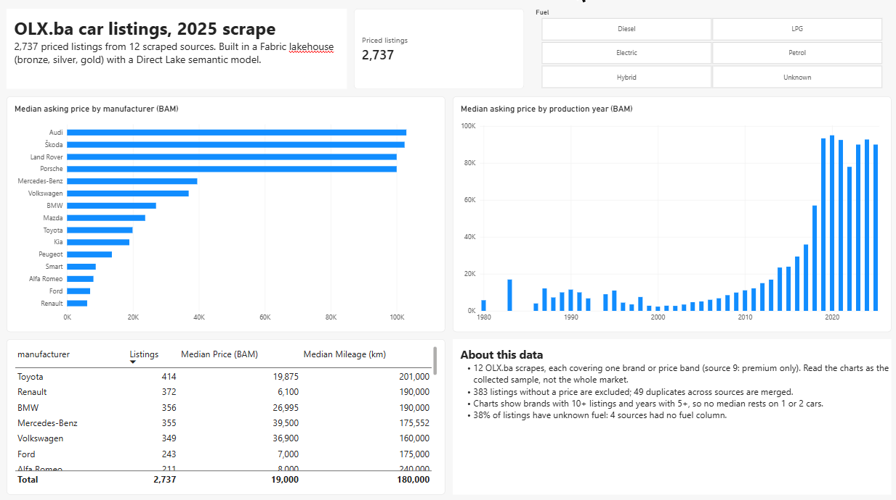

# vehicle-data-fabric

A first end-to-end build in a Microsoft Fabric trial, on my own data: 3,171 used-car listings scraped from OLX.ba across 12 files with mismatched schemas, taken from raw CSV to a Power BI report.

## What's in it

| Layer | Fabric item | What happens |
|---|---|---|
| Bronze | Lakehouse `Files/bronze/` + `bronze_listings` | 12 raw CSVs as uploaded, stacked into one table, everything still text |
| Silver | `silver_listings`, `silver_rejects` | numbers parsed, units converted, duplicates merged, bad rows kept with a reason |
| Gold | `fact_listing`, `dim_manufacturer`, `dim_fuel` | star schema for reporting |
| Model | `vehicles_model` (Direct Lake) | 2 relationships, measures for listings, median price, median mileage, diesel listings and brand share (`CALCULATE`) |
| Report | `vehicles_report` | brand and year price charts, fuel slicer, brand table, data caveats |

The notebook is [notebooks/vehicle_medallion.ipynb](notebooks/vehicle_medallion.ipynb). Click-by-click setup: [docs/fabric-steps.md](docs/fabric-steps.md).

## Where it came from

The cleaning logic is a port of my course project [vehicle-data-lab](https://github.com/vrosi21/vehicle-data-lab) (pandas, built for an ML model) to PySpark and Delta tables in a Fabric lakehouse. Full change log: [docs/port-notes.md](docs/port-notes.md).

## The quality gate

The notebook stops before building gold if any check fails:

- the number parser passes 11 known cases (`11.999 KM`, `350.000km`, `7450.0`, `Na upit`, ...)
- every raw row is accounted for: silver + rejected + merged duplicates = raw
- `listing_id` is unique, no silver row lacks a price, no price failed to parse
- regression checks for the bugs below

## What porting found

Moving the code to a new engine exposed three bugs in my original pandas version:

1. **Mileage 1000x too small in 739 rows.** The regex kept the dots, so `350.000km` became 350 km.
2. **One source labelled horsepower as kW.** Its values matched the horsepower attribute in 45 of 45 rows, and 8 real cars were then dropped as "over 600 kW".
3. **9 duplicates missed.** `www.olx.ba/...` and `olx.ba/...` were treated as different listings. Now matched on the listing ID.

## Decisions

- **No imputation.** The ML version filled gaps with mean/median. A report shows missing as missing; a listing without a price is rejected.
- **Bad values don't drop good rows.** An impossible power value (0, 5575 kW) becomes missing; the price stays.
- **Small groups are hidden.** Charts show brands with 10+ listings and years with 5+, so no median rests on one or two cars.
- **Years are labels.** `production_year` is set to "don't summarize" in the model.

## Caveats

- Each source scraped one brand or price band (source 9 only premium listings), so this is the collected sample, not the market.
- 38% of listings have unknown fuel: 4 sources had no fuel column.
- Some sellers type horsepower into the kW field; that can't be fixed without parsing titles.

## Dev → Test

- A deployment pipeline promotes the four items from `vehicle-data-dev` to a Test workspace. Definitions move, data doesn't: the Test lakehouse arrives empty and the Test model binds to it, so Test gets its own load.
- Testing with Test's own data turned up an empty "(Blank)" tile in the fuel slicer. It was fixed in Dev (a measure filter that only shows tiles with listings) and promoted, not patched in Test.
- Native Git sync was disabled by the tenant's policy, so the item definitions in `fabric/` were exported with the Fabric CLI (`fab bulk-export`) and committed by hand.

## Repo layout

| Path | Contents |
|---|---|
| `data/raw/` | the 12 source CSVs |
| `notebooks/vehicle_medallion.ipynb` | the notebook, importable into Fabric |
| `fabric/` | item definitions exported from the workspace: notebook, lakehouse, semantic model (TMDL), report (PBIR) |
| `local/run_local.py` | runs the notebook with local Spark, no Fabric needed |
| `docs/` | setup guide, port notes, report screenshot |

## Run it

1. Fabric workspace on a trial or F capacity, a lakehouse, the 12 files from `data/raw/` in `Files/bronze/`.
2. Import the notebook, attach the lakehouse as default, Run all. Expect `to_number: 11/11 cases pass`, seven `PASS` lines and `silver_listings: 2737 rows`.
3. New semantic model on the three gold tables, add relationships and measures (see `docs/fabric-steps.md`).

Locally (PySpark + Java): `python local/run_local.py` runs the same notebook against `data/raw/`.

## Next

- A scheduled Data Pipeline instead of manual uploads
- Native Git integration on a tenant that allows it, replacing the manual export

## How it was built

Built on 3 Nov 2026 in a Fabric trial, my first time using Fabric. Claude Code drafted the PySpark port from my original notebook and laid out the report through the browser. I set up the workspace, lakehouse and semantic model, ran and reviewed everything, and decided what to keep. The quality checks, not the AI, decided which output was trusted.
